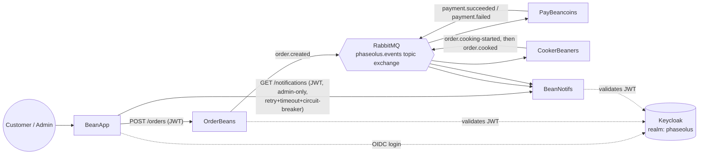
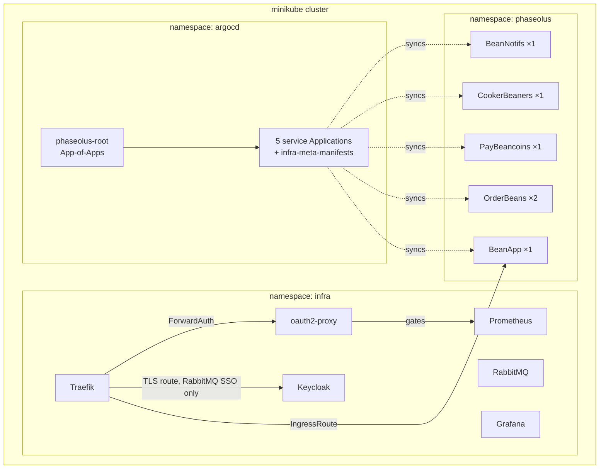

# M321_TBZ_Phaseolus_Express

**Phaseolus Central** is the meta/orchestration repo for **Phaseolus Express** — a webapp for ordering bean food, built as a microservice architecture for module M321 (TBZ). It uses Kubernetes (via minikube) to spin up the five services below (each its own repo), plus the infrastructure (message broker, IAM, observability, CI/CD) they run on. See `docs/CLAUDE.md` for the full project background.

## Architecture

**Service boundaries and data flow** — solid arrows are synchronous HTTP calls, arrows through RabbitMQ are asynchronous pub/sub (labeled by routing key), dotted arrows are OIDC/JWT validation against Keycloak:

**Deployment topology** — everything runs in one minikube cluster, services deployed via Argo CD's App-of-Apps pattern, infra Helm-managed directly:

### Error handling & resilience

- **Bounded retry with backoff.** Each RabbitMQ consumer re-publishes a failed message to the same routing key with an incrementing `x-retry-count` header (survives pod restarts, since the count lives in the message, not in memory), capped at 5 attempts before logging and dropping — no dead-letter exchange. See `docs/plans/2026_10_message-contracts-hardening/00_current_state.md`.
- **Idempotent redelivery.** Every consumer (`PayBeancoins`, `CookerBeaners`, `BeanNotifs`) guards against double-processing a redelivered message via an `EventId` dedup check. See `docs/plans/2026_10_message-contracts-hardening/`.
- **Resilient synchronous call.** BeanApp's one synchronous service-to-service call (fetching `/notifications` from BeanNotifs for the admin page) goes through a standard retry/timeout/circuit-breaker handler (`Microsoft.Extensions.Http.Resilience`). See `docs/plans/2026_10_observability-and-resilience/`.
- **Horizontal scaling.** `OrderBeans` runs 2 replicas behind its Service, load-balanced by Kubernetes — it's the only stateless-and-scaled service today; the other three carry the per-pod idempotency state above, which would need to become shared before they could scale the same way.

## Services

- [BeanApp](https://github.com/Timposter8107/M321_TBZ_Phaseolus_WebApp) — checkout UI, admin log
- [OrderBeans](https://github.com/Timposter8107/M321_TBZ_Phaseolus_Order) — order intake
- [PayBeancoins](https://github.com/Timposter8107/M321_TBZ_Phaseolus_Pay) — payment processing
- [CookerBeaners](https://github.com/Timposter8107/M321_TBZ_Phaseolus_Cooker) — order fulfillment
- [BeanNotifs](https://github.com/Timposter8107/M321_TBZ_Phaseolus_Notifs) — notifications

## Infrastructure

- **Message broker:** RabbitMQ
- **Orchestration:** Kubernetes
- **Clustering:** minikube
- **API gateway:** Traefik
- **IAM:** Keycloak
- **Metrics/monitoring:** Prometheus and Grafana
- **Deployment:** Argo CD

## Getting started

`./setup.sh` brings up the entire system from scratch on a fresh machine — minikube cluster, infra, all five services built and deployed, Argo CD wired up. See the script's own header comments for prerequisites.
