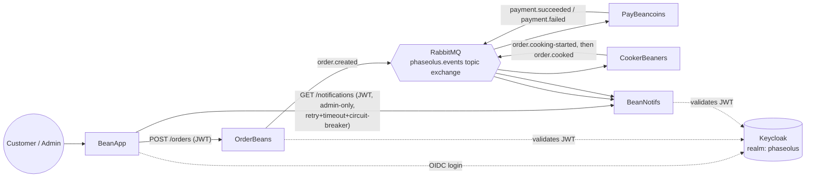
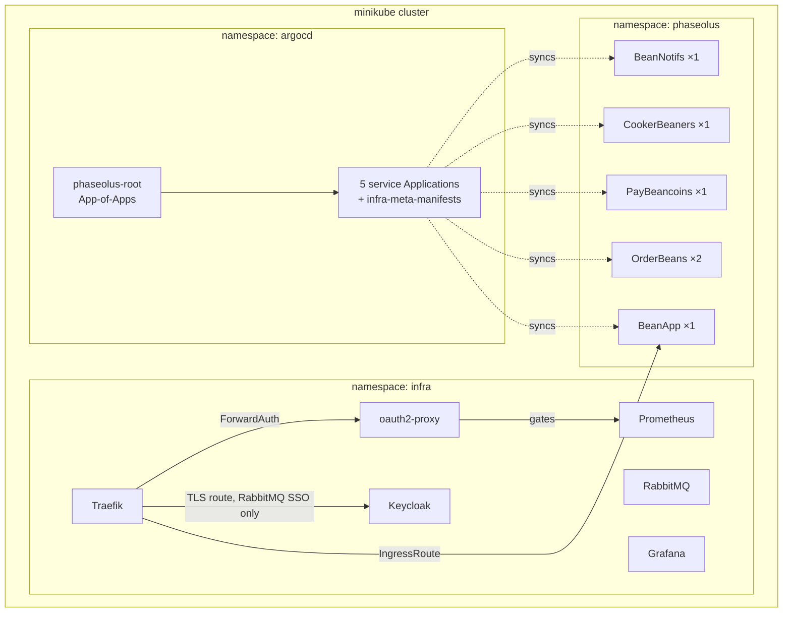

# 40 — Implementation

Step plan for closing the grading rubric's documentation (criterion 1, 5 pts) and repo/CI (criterion 8, 5 pts) gaps. This plan skipped the full staged process (`inputs.md` → `30_open_questions.md`) by deliberate choice — see `README.md` — since neither criterion involves a real design decision to weigh.

## Plan summary

Two fully independent steps. **Step 1 (architecture diagrams)** is pure documentation, one repo, no code or infra risk. **Step 2 (CI pipelines)** is config-only (`.github/workflows/*.yml`), one file per repo, no behavior change to any service. Order doesn't matter between them; listed in rubric-criterion order.

**Verified before committing to Step 2's exact shape:** `dotnet format --verify-no-changes` passes cleanly today in all 5 service repos (checked live) — so a lint gate can be added without first needing to fix a backlog of formatting violations.

**Post-execution note:** Step 1 went exactly as planned. Step 2 found a real bug (WebApp's nested `.csproj` path, fixed in a follow-up PR) and a real GitHub Actions quirk (new `pull_request` workflows don't fire on their own introducing PR) that briefly looked like a hard blocker before turning out not to be — both are detailed under Step 2 below.

## Steps

### Step 1 — Architecture diagrams in the root README

✅ **Done.** [PR #26](https://github.com/Mattyrab/M321_TBZ_Phaseolus_Express/pull/26). Both diagrams and the error-handling/resilience prose added exactly as planned.

**Verified:** rendered both diagrams with `@mermaid-js/mermaid-cli` using the exact file content (including `<br/>` tags and the `×` character) before committing — 0 syntax errors, confirmed independently of GitHub's own renderer.

**Original plan (executed as written):** replace this meta repo's root `README.md` (previously a flat bullet list of service names and infra tool names, no diagram) with two Mermaid diagrams plus the same service/infra context, aiming past "Ideal" (a diagram showing service boundaries/protocols/responsibilities) toward "Maximal" (sync *and* async data flows, error handling, deployment topology) by using two complementary diagrams rather than one overcrowded one:

**Diagram 1 — service boundaries and data flow** (sync HTTP solid, async RabbitMQ pub/sub labeled by routing key, OIDC validation dotted):



**Diagram 2 — deployment topology:**



Below the diagrams, keep short prose sections for: **Error handling & resilience** (bounded retry-with-backoff via an `x-retry-count` message header, 5 attempts, no dead-letter exchange — link `../2026_10_message-contracts-hardening/`; `EventId` idempotency dedup — same link; the retry/timeout/circuit-breaker handler on BeanApp's one synchronous call — link `../2026_10_observability-and-resilience/`) and **Services** (the existing bullet list of repo links, kept, since it's still useful navigation). Don't touch any of the 5 service repos' own one-line READMEs — a system overview belongs in the meta repo, not duplicated five times.

**Verify.** Render the README on GitHub (Mermaid renders natively) and confirm both diagrams display without syntax errors. Read it as a newcomer would: can you identify every service boundary, every protocol (sync vs. async), and the deployment topology from this doc alone, without opening any code? That's the Ideal-tier bar; the error-handling prose and second diagram are what reach for Maximal.

---

### Step 2 — CI pipelines (lint + build) for all 6 repos

✅ **Done.** PRs: [WebApp #12](https://github.com/Timposter8107/M321_TBZ_Phaseolus_WebApp/pull/12) + [fix #13](https://github.com/Timposter8107/M321_TBZ_Phaseolus_WebApp/pull/13), [OrderBeans #9](https://github.com/Timposter8107/M321_TBZ_Phaseolus_Order/pull/9), [PayBeancoins #8](https://github.com/Timposter8107/M321_TBZ_Phaseolus_Pay/pull/8), [CookerBeaners #7](https://github.com/Timposter8107/M321_TBZ_Phaseolus_Cooker/pull/7), [BeanNotifs #9](https://github.com/Timposter8107/M321_TBZ_Phaseolus_Notifs/pull/9), [meta repo #27](https://github.com/Mattyrab/M321_TBZ_Phaseolus_Express/pull/27).

**A real bug this step's own verification bar caught:** the plan's original assumption (below) that `dotnet restore`/`build`/`format` would auto-discover `WebApp`'s nested `.csproj` (`WebApp/WebApp/WebApp.csproj`, unlike the other four repos' root-level `.csproj`) was wrong. Confirmed live: the first real CI run after merging PR #12 failed with `MSB1003: Specify a project or solution file` — `dotnet` doesn't glob-discover a single nested project from the working directory. Fixed with an explicit project path in PR #13, which passed in 39s. This is exactly why the plan called for watching an *actual* green run, not trusting well-formed YAML — the bug only surfaced there.

**Also discovered: a genuine GitHub Actions quirk, not a bug.** A brand-new `pull_request`-triggered workflow does not run on the very PR that introduces it — it only starts firing once the workflow file exists on the base branch (i.e., after that first PR merges). This produced a false alarm mid-step: `gh api .../actions/runs` showing `total_count: 0` on the open PRs looked like Actions might be disabled at the repo-settings level, which would have been a real blocker needing admin access to fix. It wasn't — once each PR merged, the `push`-triggered run fired immediately and passed. Worth knowing for next time: a new workflow's silence on its own introducing PR isn't evidence of anything broken.

**Verified, every repo, via a real post-merge run (not just a syntactically-valid YAML file):** meta repo `shellcheck` — 4-7s, pass. WebApp `build` (post-fix) — 39-43s, pass. OrderBeans — 25s, pass. PayBeancoins — 36s, pass. CookerBeaners — 39s, pass. BeanNotifs — 35s, pass.

**Original plan (executed as written, modulo the WebApp fix above):** no test projects exist anywhere in this project (checked: zero `Microsoft.NET.Test.Sdk`/xunit/nunit/MSTest references in any `.csproj`), so the rubric's "Linter/Tests" is satisfied via lint + build, not tests. Add `.github/workflows/ci.yml` to each of the 5 service repos:

```yaml
name: CI
on:
  push:
    branches: [main]
  pull_request:
jobs:
  build:
    runs-on: ubuntu-latest
    steps:
      - uses: actions/checkout@v4
      - uses: actions/setup-dotnet@v4
        with:
          dotnet-version: "8.0.x"
      - run: dotnet restore
      - run: dotnet build --no-restore
      - run: dotnet format --verify-no-changes
```

(`WebApp`'s `.csproj` lives at `WebApp/WebApp/WebApp.csproj`, not the repo root — **this assumption turned out to be wrong, see the Done note above**: `dotnet restore`/`build`/`format` do *not* auto-discover a single nested project from the repo root; `WebApp`'s actual workflow needed an explicit path to each command.)

Add a much smaller `.github/workflows/ci.yml` to this meta repo too — it has no .NET project, but `setup.sh` is the single most important script in the whole system and has no syntax check today:

```yaml
name: CI
on:
  push:
    branches: [main]
  pull_request:
jobs:
  shellcheck:
    runs-on: ubuntu-latest
    steps:
      - uses: actions/checkout@v4
      - run: bash -n setup.sh
```

**Verify.** Push each branch and confirm the workflow actually runs and passes in the GitHub Actions tab (not just that the YAML is well-formed) — for the 5 service repos, confirm `dotnet build` and `dotnet format --verify-no-changes` both pass (already checked locally above, but the CI environment restoring packages fresh is a different, worth-confirming code path than a local build with packages already cached). For the meta repo, confirm the `bash -n` step passes.

## Rollback / blast radius

Both steps are purely additive and trivially reversible — a documentation file and six new CI workflow files, nothing that touches running services, deployed infrastructure, or committed data. Deleting any of the new files fully reverts that step.

## Quality gates before merging

- Step 1: visual review of the rendered README on GitHub (Mermaid syntax errors only show up at render time, not at commit time).
- Step 2: the CI workflow itself is the quality gate — watch it actually run green on first push for each of the 6 repos, don't just trust the YAML is syntactically plausible.

---

**Exit criterion:** Every step ✅, gates green, PR merged. Mark ✅ in `README.md` when complete.
